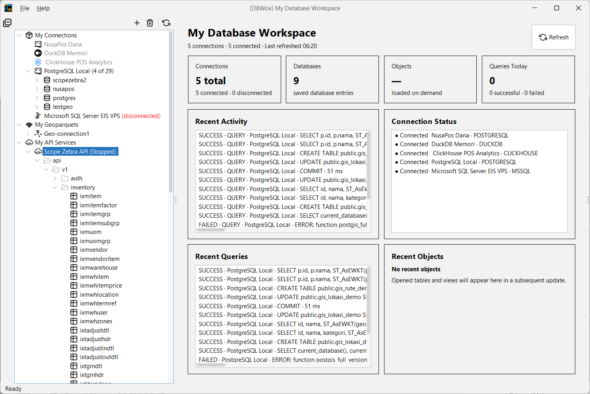
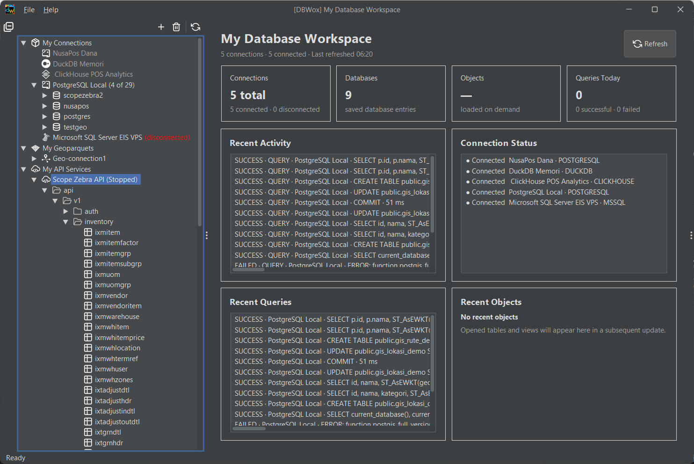

<div align="center">
  

# DbWox

**Aplikasi desktop database modern, SQL workspace, AI Assistant, GIS Viewer, dan platform pembuat kode API.**

[](https://github.com/takatws/dbwox/releases/tag/v1.0.2)
[](#persyaratan-sistem)
[](https://adoptium.net/)
[](#dukungan-database)

[English](README.md) · [Bahasa Indonesia](README-id.md)

DbWox membantu developer dan tim database untuk mengeksplorasi koneksi, menulis dan menjalankan SQL, memeriksa objek database, mengolah data geospasial, menggunakan SQL berbantuan AI, serta membuat project API dari metadata database.

</div>

## Pratinjau Aplikasi

DbWox menyediakan antarmuka desktop yang nyaman digunakan dalam mode gelap maupun terang.

<table>
  <tr>
    <td align="center"><strong>Mode Terang</strong></td>
    <td align="center"><strong>Mode Gelap</strong></td>
  </tr>
  <tr>
    <td width="50%"></td>
    <td width="50%"></td>
  </tr>
</table>

## DBWox 1.0.2

**DBWox 1.0.2 — Yang Baru**

- **Query Editor:** SQL Outline, expand/collapse query, autocomplete lebih lengkap, serta dukungan file SQL besar.
- **SQL Problems:** validasi tabel/kolom, deteksi kolom ambigu, dan quick fix melalui intentionBulb atau **Alt+Enter**.
- **Database Explorer:** mode verbose dengan detail kolom, keys, dan indexes; refresh background serta penyimpanan posisi treeview.
- **Pencarian:** Find Usages, Search Database Objects, panel Property, dan navigasi langsung ke objek.
- **Export/Import:** Function Mapping berbasis CSV, perluasan terjemahan view dan CTE, serta pemilihan dependensi view.
- **SQL Dump:** cakupan objek lebih lengkap, pengurutan dependensi, dan format routine yang lebih rapi.
- **Optimizer & Tampilan:** skor dan rekomendasi Before/After, penyempurnaan tema Light/Dark, preview SQL berwarna, dan splash screen baru.

*Dukungan lintas database mengikuti kemampuan engine dan izin akses metadata.*

**[Unduh DBWox 1.0.2 untuk Windows](https://github.com/takatws/dbwox/releases/download/v1.0.2/DBWox-1.0.2.exe)** · [Detail rilis](https://github.com/takatws/dbwox/releases/tag/v1.0.2)

## Fitur Utama

- Query Editor dengan syntax highlighting, auto-complete, riwayat query, recent files, dan navigasi multi-result.
- Koneksi database JDBC dengan lazy loading, status koneksi Open/Closed, Connect/Disconnect, dan SSH Tunnel.
- AI Assistant dengan profil Gemini/OpenAI, persetujuan akses database, SQL highlighting, serta aksi Copy/Insert/Run.
- GIS Viewer dan explorer My Geoparquets.
- Embedded API Service berbasis JWT dengan Auth Endpoint, Sub-API, resource CRUD, Search Endpoint, Custom SQL Endpoint, dan transaksi Header-Detail.
- Dukungan Swagger/OpenAPI dan export collection Postman.
- Code generator untuk Spring Boot, Quarkus, Express, Go, Laravel, Python, ASP.NET Core, dan Rust.

## Dukungan Database

DbWox menggunakan konektivitas JDBC dan mendukung database yang tersedia melalui JDBC driver, termasuk:

- PostgreSQL
- Microsoft SQL Server
- Database yang kompatibel dengan MySQL
- DuckDB
- Sistem database lain yang kompatibel dengan JDBC

## API Code Generator

Project hasil generate dapat mencakup autentikasi, akses database, route CRUD, custom endpoint, serta dokumentasi Swagger/OpenAPI.

| Platform | Framework / Opsi |
|---|---|
| Java | Spring Boot dengan JPA atau JdbcTemplate; Quarkus dengan Panache; Maven atau Gradle |
| JavaScript / TypeScript | Express, ESM, npm/pnpm/yarn/bun, Prisma atau Drizzle |
| Golang | Gin, Fiber, Echo |
| PHP | Laravel, Sanctum, tymon JWT |
| Python | Flask, FastAPI, SQLAlchemy, SQLModel |
| C# | ASP.NET Core, Entity Framework Core, Dapper |
| Rust | Axum, Actix-Web, SQLx PostgreSQL |

## AI Assistant

AI Assistant dirancang sebagai teman database untuk sesi Query Editor aktif. AI dapat membuat SQL PostgreSQL, menjelaskan atau mengoptimalkan query terpilih, membaca metadata yang telah disetujui, serta menjalankan operasi read-only yang telah disetujui. Credential dan rahasia database tidak dikirim ke provider AI.

## Instalasi

### Windows

1. Buka [rilis terbaru](https://github.com/takatws/dbwox/releases/tag/v1.0.2).
2. Unduh file `DBWox-1.0.2.exe`.
3. Jalankan installer dan ikuti wizard instalasi.
4. Jika Windows menampilkan peringatan sertifikat self-signed, instal file `.cer` hanya jika installer berasal dari sumber release yang tepercaya.

### Linux dan macOS

DbWox berbasis Java dan dapat dijalankan dari source atau JAR hasil build pada Linux dan macOS. Gunakan Java 26+ dan pastikan JDBC driver yang dibutuhkan tersedia. Installer khusus platform dapat disediakan pada rilis mendatang.

## Persyaratan Sistem

- Windows 10 atau Windows 11 64-bit untuk installer resmi Windows.
- Distribusi Linux dengan Java 26+.
- macOS dengan Java 26+.
- Java 26 atau versi lebih baru untuk JAR 1.0.2; installer Windows menyertakan runtime.
- JDBC driver untuk setiap database yang ingin digunakan.
- Akses jaringan ke database dan server SSH jika diperlukan.

## Build dari Source

Aplikasi desktop dibangun menggunakan Maven:

```powershell
cd Source\java
mvn clean package
```

Project hasil generate menggunakan build tool masing-masing. Contoh project Rust:

```powershell
cargo fmt
cargo check
cargo test
cargo build
```

Contoh project Java:

```powershell
mvn clean package
```

## Catatan Keamanan

- Endpoint API dapat dilindungi menggunakan JWT Bearer authentication.
- Metadata database dan hasil query memerlukan persetujuan sebelum dikirim ke provider AI.
- SQL tidak dijalankan otomatis oleh AI Assistant.
- Jangan memasukkan API key, password database, credential SSH, atau file koneksi production ke repository atau issue.

## Catatan Rilis

Lihat [RELEASE-NOTES-1.0.2.md](RELEASE-NOTES-1.0.2.md) untuk catatan rilis 1.0.2 dalam dua bahasa. Untuk rilis sebelumnya, lihat [readme-1.0.1.md](readme-1.0.1.md).

## Kontribusi

Laporan bug, saran fitur, dan pull request sangat diterima. Sertakan versi DbWox, sistem operasi, database engine, dan langkah reproduksi saat membuat laporan.

## Lisensi

Lihat file [LICENSE](LICENSE) untuk ketentuan lisensi.

## Dukungan

Untuk pertanyaan dan laporan bug, gunakan halaman [Issues](../../issues) repository.

## Donasi dan Dukungan Riset

Jika DbWox membantu pekerjaan, riset, atau pembelajaran Anda, dukung pengembangan berkelanjutan melalui opsi kontribusi yang tersedia di repository.
