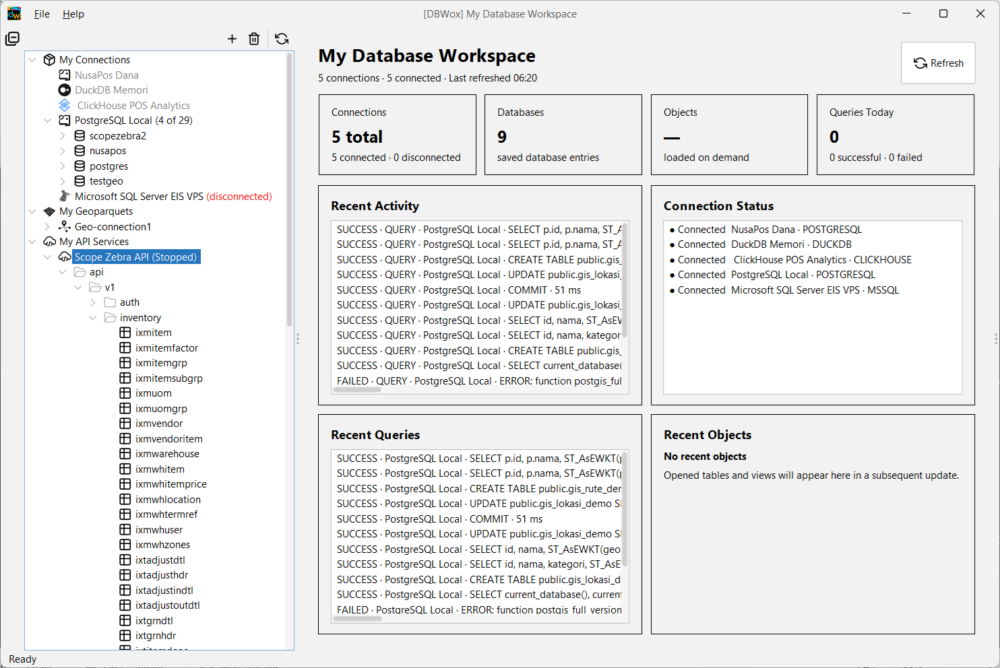
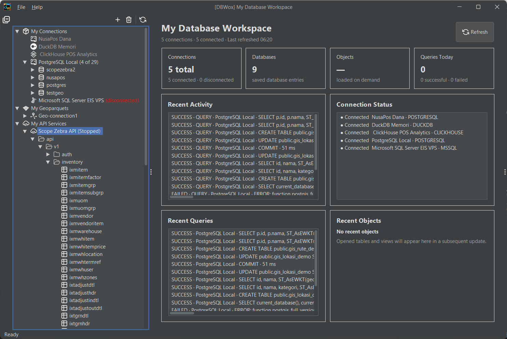

<div align="center">
  

# DbWox

**A modern desktop database client, SQL workspace, AI assistant, GIS viewer, and API code-generation platform.**

[](../../releases/latest)
[](#system-requirements)
[](https://adoptium.net/)
[](#database-support)

[English](README.md) · [Bahasa Indonesia](README-id.md)

DbWox helps developers and database teams explore connections, write and run SQL, inspect database objects, work with geospatial data, use AI-assisted SQL, and generate production-ready API projects from database metadata.

</div>

## Application Preview

DbWox provides a comfortable dark and light desktop interface for database work.

<table>
  <tr>
    <td align="center"><strong>Light Mode</strong></td>
    <td align="center"><strong>Dark Mode</strong></td>
  </tr>
  <tr>
    <td width="50%"></td>
    <td width="50%"></td>
  </tr>
</table>

## Current Version

**DbWox 1.0.1**

Download the latest Windows installer from the [Releases](../../releases/latest) page.

## Highlights

- SQL Query Editor with syntax highlighting, auto-completion, query history, recent files, and multi-result navigation.
- JDBC database connections with lazy loading, Open/Closed connection state, Connect/Disconnect actions, and SSH tunneling.
- AI Assistant with Gemini/OpenAI profiles, permission-aware database tools, SQL highlighting, and Copy/Insert/Run actions.
- GIS Viewer and My Geoparquets explorer.
- Embedded JWT API Services with Auth endpoints, Sub-APIs, CRUD resources, Search endpoints, Custom SQL endpoints, and Header-Detail transactions.
- Swagger/OpenAPI link support and Postman collection export.
- Code generation for Spring Boot, Quarkus, Express, Go, Laravel, Python, ASP.NET Core, and Rust.

## Database Support

DbWox uses JDBC-based connectivity and supports database engines available through configured JDBC drivers, including:

- PostgreSQL
- Microsoft SQL Server
- MySQL-compatible databases
- DuckDB
- Other JDBC-compatible database systems

## API Code Generator

Generated projects include authentication, database access, CRUD routes, custom endpoints, and optional Swagger/OpenAPI documentation.

| Platform | Frameworks / Options |
|---|---|
| Java | Spring Boot with JPA or JdbcTemplate; Quarkus with Panache; Maven or Gradle |
| JavaScript / TypeScript | Express, ESM, npm/pnpm/yarn/bun, Prisma or Drizzle |
| Go | Gin, Fiber, Echo |
| PHP | Laravel, Sanctum, tymon JWT |
| Python | Flask, FastAPI, SQLAlchemy, SQLModel |
| C# | ASP.NET Core, Entity Framework Core, Dapper |
| Rust | Axum, Actix-Web, SQLx PostgreSQL |

## AI Assistant

The AI Assistant is designed as a database companion for the active Query Editor session. It can generate PostgreSQL SQL, explain or optimize selected queries, inspect approved metadata, and execute approved read-only operations. Credentials and database secrets are not sent to the configured AI provider.

## Installation

### Windows

1. Open the [latest release](../../releases/latest).
2. Download `DBWox-<version>.exe`.
3. Run the installer and follow the setup wizard.
4. If Windows displays a warning for the self-signed certificate, install the included `.cer` certificate only when the installer was downloaded from a trusted release source.

### Linux and macOS

DbWox is Java-based and can be run from source or a packaged JAR on Linux and macOS. Use a Java 17+ runtime and make sure the required JDBC drivers are available. Platform-specific installers may be provided separately in future releases.

## System Requirements

- Windows 10 or Windows 11, 64-bit, for the official Windows installer.
- Linux distribution with a supported Java 17+ runtime.
- macOS with a supported Java 17+ runtime.
- Java 17 or newer.
- A JDBC driver for each database engine you want to connect to.
- Network access to remote databases and SSH servers when applicable.

## Building from Source

The desktop application is built with Maven:

```powershell
cd Source\java
mvn clean package
```

The generated projects use their own build tools. For example:

```powershell
# Java
mvn clean package

# Rust
cargo fmt
cargo check
cargo test
cargo build
```

## Security Notes

- API endpoints can require JWT Bearer authentication.
- Database metadata and query results require explicit approval before being sent to an AI provider.
- SQL is not executed automatically by the AI Assistant.
- Never publish API keys, database passwords, SSH credentials, or production connection files in a repository or issue.

## Release Notes

See [readme-1.0.1.md](readme-1.0.1.md) for the detailed v1.0.1 changelog.

## Contributing

Bug reports, feature suggestions, and pull requests are welcome. Please include the DbWox version, operating system, database engine, and a reproducible description when reporting an issue.

## License

See the [LICENSE](LICENSE) file for licensing terms.

## Support

For questions and bug reports, use the repository's [Issues](../../issues) page.

## Donations and Research Support

If DbWox helps your work, research, or learning, consider supporting continued development through the contribution options listed on the project repository.
